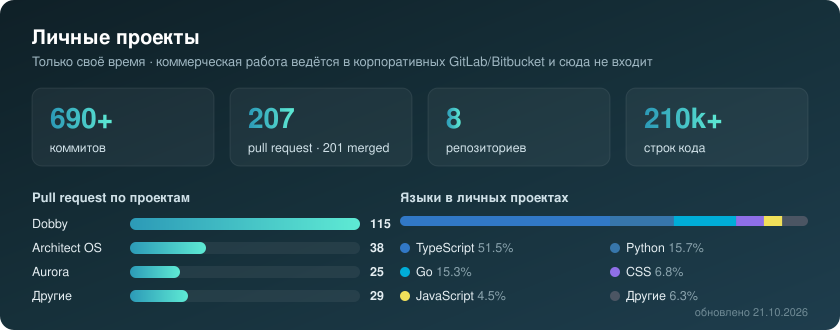

---

## 👋 Обо мне

Senior Java-разработчик с **6+ годами** опыта проектирования и поддержки высоконагруженных
распределённых систем в **финтехе** и **телекоме**.

- 🏦 **Финтех** — корпоративная кредитная платформа крупного банка: Kafka + Camunda BPM, согласования по SLA, миграция Java 17 → 21
- 📡 **Intech** — телеком-платформа на **200+ млн абонентов**: миграция 20 млн абонентов между биллингами без простоя, IVR-платформа, интеграции с AmoCRM / Bitrix24
- 🤖 В свободное время строю собственные **AI-продукты** целиком — от архитектуры до деплоя — и модифицирую прошивки AI-роботов на ESP32
- 🎤 **5 лет помогаю в организации IT-конференций [JUG Ru Group](https://jugru.org)**
- 🎓 Вёл курс и проводил консультации в Иннополисе
- ⚡ Быстро погружаюсь в незнакомый код: меня перебрасывали в смежные команды «усилением» — входил в legacy за 1–2 недели

---

## 🏆 Чем горжусь на работе

<table>
<tr>
<td width="50%" valign="top">

### 📡 Миграция 20 млн абонентов
Отказоустойчивый микросервис переноса абонентов между биллинговыми системами.
**Чанковая обработка, идемпотентные ключи, возобновление с точки сбоя.**

`Java` `Kotlin` `Spring` `PostgreSQL` `Redis` `Kafka`

</td>
<td width="50%" valign="top">

### 🏦 Уведомления по кредитным заявкам
Система уведомлений по статусам заявок на **Kafka + Camunda BPM**: матрица ролей,
эскалации по SLA, параллельные ветки согласования.

`Java 21` `Spring Boot 3` `Camunda 7` `Kafka` `gRPC`

</td>
</tr>
<tr>
<td width="50%" valign="top">

### ☎️ IVR-платформа для корпоративных АТС
Конфигурируемые голосовые меню, маршрутизация, интеграции с CRM и платёжными шлюзами.

`Asterisk` `Spring` `PostgreSQL` `GitLab CI`

</td>
<td width="50%" valign="top">

### 🚀 Java 17 → 21 и производительность
Миграция ключевых сервисов, оптимизация тяжёлых SQL и схем PostgreSQL,
профилирование JVM и устранение утечек памяти.

`JVM` `PostgreSQL` `Testcontainers` `Prometheus`

</td>
</tr>
</table>

---

## 🛠 Стек

**Основной — Java backend**

**Инфраструктура и наблюдаемость**

**Пет-проекты и AI**

<b>Полный список</b>

 

| Область | Технологии |
|---|---|
| Языки | Java 11 / 17 / 21, Kotlin, Go, Python, TypeScript, SQL |
| Spring | Boot 3, MVC, Data JPA, Cloud, Security, Actuator, AOP |
| Интеграция | Apache Kafka, gRPC, REST, GraphQL, OpenAPI / Swagger, Camunda BPM 7 |
| Данные | PostgreSQL, Redis, MongoDB, Elasticsearch, MinIO / S3, Hibernate, MyBatis, Liquibase, Flyway |
| Тесты | JUnit 5, Mockito, AssertJ, Testcontainers, WireMock, JaCoCo |
| Безопасность | Keycloak, OAuth2, Spring Security |
| DevOps | Docker, Kubernetes, GitLab CI, TeamCity, Linux |
| Наблюдаемость | Prometheus, Micrometer, Grafana, Jaeger, ELK, Logstash |

---

## 🚀 Мои продукты

> Собственные проекты, которые я проектирую и развиваю целиком: архитектура, backend, frontend, тесты, CI и деплой.
> Репозитории закрытые (коммерческая лицензия) — **код и демо покажу на собеседовании**.

<table>
<tr>
<td valign="top" width="33%">

### 🧩 Dobby
**Экосистема Telegram Mini Apps** на едином аккаунте: English, Fitness, Cooking, Career, Work и другие модули поверх общего Core — XP, стрики, достижения, биллинг, AI.

- Go backend: API + worker, модульные домены
- Telegram-авторизация, биллинг: Stars и Crypto Pay
- ~100 миграций PostgreSQL, 400+ тестовых файлов
- ADR, доменная модель, события

`115 PR` · `150k+ строк`

</td>
<td valign="top" width="33%">

### 🏛 Architect OS
**Студия проектирования архитектуры с ИИ.** Описываешь систему в чате — получаешь схему, ADR, ревью и пакет задач для AI-агентов.

- Анализ готового репозитория без запуска: Compose, K8s, Terraform, манифесты
- ~50 правил поиска уязвимостей и SPOF
- Оценка RPS, узких мест и доступности
- 9 LLM-провайдеров, учёт токенов и стоимости

`38 PR` · `24k строк`

</td>
<td valign="top" width="33%">

### ✨ Aurora
**Self-hosted AI-ассистент.** Почта, календарь, Telegram, задачи и напоминания в одной панели. Поручения обычными словами, подтверждение перед действиями.

- Gmail, Calendar, Notion, Slack, Linear, GitHub и ещё 15+ интеграций
- MCP, субагенты с узкими правами
- Планировщик, GTD-доска, Telegram-бот
- Docker, деплой на VPS одной командой

`25 PR` · `32k строк`

</td>
</tr>
</table>

### 🔓 Open source

| Проект | Что это |
|---|---|
| [**Vibe Island**](https://github.com/Denis-VR/Vibe_iseland) · [vibeisland.fun](https://vibeisland.fun) | «Тихая высота» — живые горные пейзажи под реальную погоду, микшер звуков на Web Audio и музыка для фокуса. React 19 · TypeScript · Node.js · SQLite |
| [**xiaozhi-esp32**](https://github.com/Denis-VR/xiaozhi-esp32) | Русская версия прошивки MCP-чатбота для AI-роботов на ESP32 (C++) |
| [**xiaozhi-esp32-server-java**](https://github.com/Denis-VR/xiaozhi-esp32-server-java) | Серверная часть для этих роботов на Java |
| [**Backend-Map**](https://github.com/Denis-VR/Backend-Map) | Карта backend-разработки: паттерны, алгоритмы, схемы, вопросы к собеседованию |

---

## 📈 Активность

Статистика только по личным проектам, которые я веду в свободное время. Основная работа (финтех, телеком) идёт в корпоративных репозиториях и сюда не попадает.

